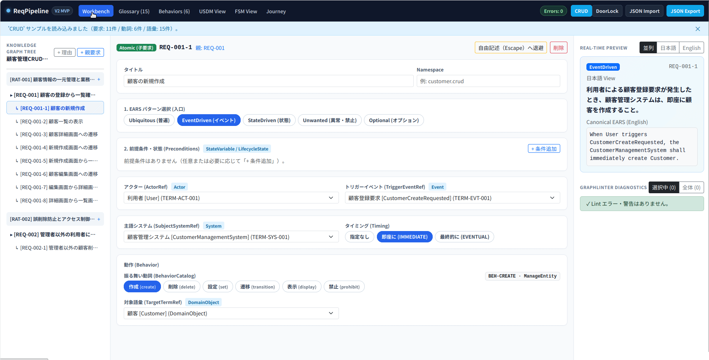

# ReqPipeline V2.0.0

[](https://dotnet.microsoft.com/)
[](https://dotnet.microsoft.com/apps/aspnet/web-apps/blazor)
[](https://opensource.org/licenses/MIT)

[🇺🇸 Read this in English](README.md)
[🇯🇵 Read this in Japanese](README_ja.md)

**ReqPipeline V2.0.0** is a deterministic requirements specification workbench, static verification engine, and test case derivation suite combining **USDM**, **EARS**, **User-Defined Behavior Catalogs**, **FSM Analysis**, **Journey Simulation**, and **Test View**.

It catches specification contradictions, missing preconditions, unreachable/dead-end states, and broken end-to-end flows **100% deterministically**, and automatically derives **Unit / Component (FSM) / E2E** test specifications exported to **Gherkin (`.feature`), CSV (UTF-8 BOM / RFC 4180), and Markdown** before a single line of implementation code is written.



## Vision & Motivation

In software and systems engineering, **requirements definition is both where defects are most easily introduced and where fixing them is cheapest**. Traditional natural-language specs suffer from:

* **Context Mismatch**: Unspoken assumptions between authors, reviewers, and developers.
* **Ambiguity & Omission**: Missing abnormal/safety conditions and undefined edge cases.
* **Silent Contradictions**: Conflicting requirements across different parts of a specification.

**ReqPipeline V2** eliminates these specification bugs upstream (Shift-Left) by modeling requirements as a strongly-typed **Knowledge Graph (`SchemaVersion = "2.0"`)** instead of free-form prose:

1. **Glossary (`ApprovedGlossaryTerm`)**: Defines `System`, `Actor`, `DomainObject`, `Attribute`, `Event`, `StateVariable`, and `LifecycleState` with closed `Boolean` / `Enum` value domains, Japanese display labels (`ValueLabels`), and banned terminology (`DeprecatedLabels`).
2. **2-Layer Behavior Architecture (`SemanticEffect` × `BehaviorCatalog`)**:
   * **4 Core Semantic Primitives (`SemanticEffect`)**: `MutateState`, `ManageEntity`, `EmitAction`, `Prohibit`.
   * **User-Defined `BehaviorCatalog` (`BehaviorDefinition`)**: Define domain-specific verbs (e.g., CRUD verbs or automotive ECU verbs like `BEH-LOCK`, `BEH-UNLOCK`, `BEH-INTERLOCK`) with allowed target types, required slots (`FromValue` / `ToValue`), and bilingual EARS templates (`{target}`, `{from}`, `{to}`, `{prohibitedAction}`).
3. **Deterministic Verification Engines**:
   * **`GraphLinter` (`LINT-001` – `LINT-013`)**: Verifies reference integrity, concept types, logical domain closure, precondition satisfiability & requirement conflicts (`LINT-008`), FSM completeness (`LINT-012`), and glossary hygiene (`LINT-009` – `LINT-011`, `LINT-013`).
   * **`FsmGraphBuilder` & `FsmMermaidRenderer`**: Builds live state-transition graphs for `LifecycleState` terms and flags unreachable or dead-end states.
   * **`JourneySimulator`**: Deterministically walks through multi-step user journeys, verifying preconditions, state transitions (`StateMismatch`), and safety interlocks (`Blocked`).
   * **`TestSpecificationGenerator` & 3-Format Exporters (`Gherkin` / `CSV` / `Markdown`)**: Deterministically derives Unit (1-condition negation & safety interlocks with full-requirement re-evaluation), Component (2D state-transition matrices), and E2E (Journey) test cases with stable natural-key IDs.
   * **Bilingual EARS / USDM Renderers**: Generates consistent Japanese and English EARS sentences plus hierarchical USDM Markdown from the single JSON source of truth.

### End-to-End Workflow (`WDD ➔ Glossary ➔ ReqPipeline V2 ➔ Test View`)

ReqPipeline V2.0.0 keeps a clean separation of responsibilities between human test analysis and deterministic test case expansion:

1. **WDD / Upstream Test Analysis (Human)**: Elicit acceptance criteria, QA *What if* questions, and non-functional/environmental viewpoints into `Rationale → CompositeRequirement` viewpoint containers.
2. **Glossary & BehaviorCatalog**: Establish closed domain vocabulary (`Boolean` / `Enum`), display labels, and domain verbs (`SemanticEffect`).
3. **ReqPipeline V2 Workbench (`GraphLinter` / `FSM` / `Journey`)**: Author structured `AtomicRequirement` specs and eliminate contradictions, dead-end states, and broken flows statically.
4. **Test View (`/tests`)**: Automatically expand viewpoint containers, 2D state-transition matrices, and E2E journeys into deterministic test cases, flag `EscapeRecord` items for manual test design, and export to **Gherkin**, **CSV**, or **Markdown**.

---

## Getting Started

ReqPipeline V2 runs cross-platform on Windows, macOS, and Linux. **No external database or LLM is required** for the V2 Web Workbench or test suite.

### 1. Prerequisites

* [**.NET 10.0 SDK**](https://dotnet.microsoft.com/download/dotnet/10.0)

### 2. Clone, Test, and Run

```bash
# Clone the repository
git clone https://github.com/boxdate/ReqPipeline.git
cd ReqPipeline

# Run the unit test suite (Core AST, GraphLinter, FSM, Journey, Samples)
dotnet test

# Run the Blazor Web Workbench
dotnet run --project src/ReqPipeline.Web
```

### 3. Open in Browser

Open the URL shown in the terminal (default: `http://localhost:5087`) in your browser.

---

## Basic Usage (Blazor Workbench)

The Web UI has 7 tabs in the header along with real-time `Errors` / `Warnings` badges, a **Sample Switcher (`CRUD` / `DoorLock`)**, and **JSON Import / Export**:

1. **Workbench (`/`)**:
   * Left pane: `Rationale → Composite → Atomic` tree hierarchy.
   * Center pane: Structured EARS 5-pattern & dynamic `BehaviorCatalog` slot editor (`TargetTermRef` filtered by `AllowedTargetTypes`, `FromValue` / `ToValue` slots, `Prohibit` target action & value slots, and Escape Hatch for non-formalizable constraints).
   * Right pane: Live Japanese & English EARS preview and real-time `GraphLinter` diagnostics.
2. **Glossary (`/glossary`)**:
   * Manage `ApprovedGlossaryTerm` entries, `Boolean` / `Enum` domains, `ValueLabels`, `DeprecatedLabels`, and Glossary JSON import/export.
3. **Behaviors (`/behaviors`)**:
   * Add, edit, and delete `BehaviorDefinition` entries in `BehaviorCatalog`. Selecting a `SemanticEffect` auto-fills recommended `AllowedTargetTypes`, slot flags, and bilingual templates with a live dummy-vocabulary preview.
4. **USDM View (`/usdm`)**:
   * Inspect and copy the generated hierarchical USDM Markdown (`Rationale → Composite → Atomic` with Japanese & Canonical English EARS).
5. **FSM View (`/fsm`)**:
   * View live Mermaid `stateDiagram-v2` diagrams and state health (`Initial`, `Reachable`, `Dead-end`, incoming/outgoing counts) for every `LifecycleState`.
6. **Journey (`/journey`)**:
   * Create and run deterministic walkthrough scenarios (`InitialStates` + `Steps`) to verify happy paths (`Passed`) and interlock/prohibition rules (`Blocked`).
7. **Test View (`/tests`)**:
   * Left pane: Viewpoint container tree (`Show All`, `Rationale → CompositeRequirement` with `EscapeRecord` manual-review badges, `FSM Transition Matrices` with undefined cell counts, and `E2E Scenarios`).
   * Right pane: Interactive 2D state-transition matrix (`ValidTransition`, `ConditionalTransition`, `ExplicitProhibit`, `UndefinedNoOp`, plus `HasProhibit` coexistence badges, "Highlight Undefined Cells Only" toggle, and click-to-expand cell details) and filtered test case cards with direct `Open in Workbench →` / `Open in Journey →` links.
   * Top bar: Summary metrics (viewpoints, total cases, Atomic requirement coverage %, undefined cells, Escape manual review count), Japanese/English toggle, and 3-format export (**Markdown** copy/DL, **CSV** UTF-8 BOM DL with optional execution columns, **Gherkin `.feature`** copy/DL with level filter).

---

## Multi-Domain Sample Datasets

Use the **`CRUD`** / **`DoorLock`** switcher in the header to explore two contrasting domains running on the exact same verification engine:

| Sample | File | Domain | Verbs in `BehaviorCatalog` | Highlights |
| --- | --- | --- | --- | --- |
| **CRUD** | `samples/crud-sample.v2.json` | Customer Management Web App | `BEH-CREATE`, `BEH-DELETE`, `BEH-SET`, `BEH-TRANSITION`, `BEH-DISPLAY`, `BEH-PROHIBIT` | 4-state screen lifecycle (`List`, `Create`, `Detail`, `Edit`), non-Admin delete prohibition (`JRN-002` `Blocked`) |
| **DoorLock** | `samples/doorlock-sample.v2.json` | Vehicle Door Lock & Warning ECU | `BEH-LOCK`, `BEH-UNLOCK`, `BEH-CHIME`, `BEH-RECORD-DTC`, `BEH-INTERLOCK` (no CRUD verbs) | Cyclic `Unlocked ⇄ Locked` FSM, half-door lock & driving unlock interlocks (`LINT-008` fires immediately if preconditions are removed), `JRN-001` `Passed` / `JRN-002` `Blocked` |

---

## Project Structure

* `src/ReqPipeline.Core/`: V2 Domain AST (`KnowledgeGraphDocument`, `BehaviorCatalogModels`), `GraphLinter`, `FsmGraphBuilder`, `JourneySimulator`, `Testing` (`TestSpecificationGenerator`, `GherkinTestExporter`, `CsvTestExporter`, `MarkdownTestExporter`), and EARS/USDM/Mermaid renderers.
* `src/ReqPipeline.Web/`: Blazor Interactive Server Workbench (`Home`, `GlossaryEditor`, `BehaviorsEditor`, `UsdmView`, `FsmView`, `JourneyView`, `TestView`).
* `tests/ReqPipeline.UnitTests/`: xUnit tests covering `GraphLinter`, `FsmGraphBuilder`, `JourneySimulator`, `TestSpecificationGenerator` + 3-format exporters, and both V2 sample datasets.
* `samples/`: V2 sample knowledge graph documents (`crud-sample.v2.json`, `doorlock-sample.v2.json`).
* `docs/requirements_dev/`: V2 design notes and implementation specifications.
* `src/ReqPipeline.Linter/`: Legacy V1 CLI prototype (optional Ollama LLM integration via `OllamaSettings__ModelName`).

---

## Contributing

ReqPipeline is an open-source project aiming for a world where everyone can write unambiguous, verifiable specifications.

### Ways to Contribute

* **Domain Sample Datasets**: Real-world `*.v2.json` knowledge graphs from embedded control, workflow, inventory, or web domains to stress-test `SemanticEffect` and `GraphLinter`.
* **Verification & Analysis Rules**: New deterministic checks, FSM/Journey diagnostics, and edge-case tests in `tests/ReqPipeline.UnitTests/`.
* **UI/UX Improvements (Blazor)**: Enhancements to the Workbench, Behaviors editor, FSM View, and Journey Simulator.
* **Bug Reports & Documentation**: Issues, reproduction steps, and bilingual documentation improvements.

### How to Start Developing

1. Fork this repository.
2. Create a new branch (`git checkout -b feature/amazing-feature`).
3. Make your changes and verify `dotnet build` and `dotnet test` pass.
4. Commit and push your branch, then open a Pull Request.

## Tested Environments

Built on .NET 10, ReqPipeline is designed for Windows, macOS, and Linux (verified on Ubuntu / Linux). Feedback and test reports on Windows and macOS (including Apple Silicon) are very welcome via Issues!
