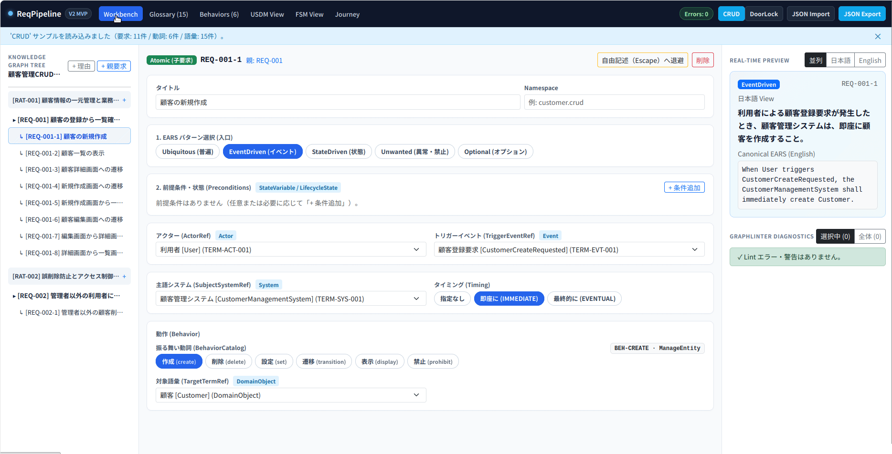

# ReqPipeline V2

[](https://dotnet.microsoft.com/)
[](https://dotnet.microsoft.com/apps/aspnet/web-apps/blazor)
[](https://opensource.org/licenses/MIT)

[🇺🇸 Read this in English](README.md)
[🇯🇵 Read this in Japanese](README_ja.md)

**ReqPipeline V2** は、**USDM**・**EARS**・**ユーザー定義 Behavior Catalog**・**FSM 解析**・**Journey シミュレーション**を組み合わせた、決定論的な要求仕様ワークベンチ＆静的検証エンジンです。

自然言語の仕様書で見落とされがちな論理矛盾・前提条件の抜け・到達不能状態や行き止まり状態・シナリオの断絶を、コードを1行も書く前に **100%決定論的** に検知します。



## 背景と解決したい課題

ソフトウェアやシステム開発において、**「要求定義フェーズ」は最もバグが混入しやすく、同時に「除去コストが最も安い」フェーズ**です。従来の自然言語ベースの要求定義では、以下のような問題が起きがちでした。

* **コンテキストの不一致**: 書き手と開発者の間にある「暗黙の了解」による認識ズレ。
* **思考の曖昧さ・考慮漏れ**: 異常系・安全インターロック・エッジケースの未定義。
* **サイレントな論理矛盾**: システム全体で見たときの、仕様同士の静かな競合。

**ReqPipeline V2** は、要求を自由記述ではなく厳格に型付けされた **知識グラフ（`KnowledgeGraphDocument`, `SchemaVersion = "2.0"`）** として扱うことで、開発の超上流で仕様バグを取り除きます（Shift-Left）。

1. **Glossary (`ApprovedGlossaryTerm`)**: `System` / `Actor` / `DomainObject` / `Attribute` / `Event` / `StateVariable` / `LifecycleState` の7種と、`Boolean` / `Enum` の閉じた値ドメイン・日本語表示ラベル（`ValueLabels`）・禁止語（`DeprecatedLabels`）を管理します。
2. **2層振る舞いアーキテクチャ（`SemanticEffect` × `BehaviorCatalog`）**:
   * **Core 固定の4意味プリミティブ (`SemanticEffect`)**: `MutateState`, `ManageEntity`, `EmitAction`, `Prohibit`。
   * **ユーザー定義 `BehaviorCatalog` (`BehaviorDefinition`)**: CRUD 動詞に限らず、車載制御等のドメイン固有動詞（例: `BEH-LOCK`, `BEH-UNLOCK`, `BEH-INTERLOCK`）を、許可対象型・必須スロット（`FromValue` / `ToValue`）・日英 EARS テンプレート（`{target}`, `{from}`, `{to}`, `{prohibitedAction}`）付きで自由に定義できます。
3. **決定論的検証エンジン**:
   * **`GraphLinter` (`LINT-001` 〜 `LINT-013`)**: 参照整合性、概念型および `AllowedTargetTypes` 一致、値ドメイン閉包、必須スロット整合性・自己禁止防止、前提条件の同時成立性を考慮した要求衝突検知（`LINT-008`: `Prohibit`＋`ProhibitedToValue` との矛盾・`MutateState` 遷移先競合）、FSM 完全性警告（`LINT-012`）、語彙規約・禁止語・未使用語彙検知（`LINT-009`〜`LINT-011`, `LINT-013`）を実行します。
   * **`FsmGraphBuilder` & `FsmMermaidRenderer`**: `LifecycleState` ごとに状態遷移グラフを構築し、到達不能状態や行き止まり（Dead-end）を自動検出して Mermaid 描画します。
   * **`JourneySimulator`**: 初期状態（`InitialStates`）から複数ステップを順に評価し、前提条件不一致（`PreconditionFailed`）、遷移元不一致（`StateMismatch`）、禁止ルール発動（`Blocked`）を決定論的に検証します。
   * **日英 EARS / USDM レンダラ**: 単一の正本 JSON から日本語 EARS・英語 Canonical EARS・階層化 USDM Markdown を自動生成します。

---

## はじめに (Getting Started)

ReqPipeline V2 は Windows / macOS / Linux で動作します。**V2 Web Workbench およびテストの実行に外部 DB や LLM（Ollama）は不要です。**

### 1. 前提条件 (Prerequisites)

* **[.NET 10.0 SDK](https://dotnet.microsoft.com/download/dotnet/10.0)**

### 2. クローン・テスト・起動

```bash
# リポジトリのクローン
git clone https://github.com/boxdate/ReqPipeline.git
cd ReqPipeline

# ユニットテストの実行（Core AST / GraphLinter / FSM / Journey / サンプル検証）
dotnet test

# Blazor Web Workbench の起動
dotnet run --project src/ReqPipeline.Web
```

### 3. ブラウザでアクセス

起動後、ターミナルに表示される URL（デフォルト: `http://localhost:5087`）にブラウザでアクセスしてください。

---

## 基本的な使い方 (Blazor Workbench)

画面上部ヘッダーには 6 つのビュー切り替えタブ、リアルタイムの `Errors` / `Warnings` バッジ、**サンプル切替（`CRUD` / `DoorLock`）**、**JSON Import / Export** があります。

1. **Workbench (`/`)**:
   * 左ペイン: `Rationale → 親要求 (Composite) → 子要求 (Atomic)` の階層ツリー。
   * 中央ペイン: EARS 5パターン選択、`BehaviorCatalog` からの動的動詞選択、`AllowedTargetTypes` でフィルタされた対象語彙選択、`RequiresFromValue` / `RequiresToValue` に応じた動的スロット、`Prohibit` 時の `ProhibitedBehaviorDefRef` / `ProhibitedToValue` 編集、および構造化できない制約を退避する Escape Hatch。
   * 右ペイン: 日英 EARS のリアルタイムプレビューと `GraphLinter` 診断結果。
2. **Glossary (`/glossary`)**:
   * 承認済み語彙（`ApprovedGlossaryTerm`）、`Boolean` / `Enum` の値ドメイン・`ValueLabels`・`DeprecatedLabels` の編集、Glossary 単体の JSON インポート／エクスポート。
3. **Behaviors (`/behaviors`)**:
   * `BehaviorCatalog`（`BehaviorDefinition`）の一覧・追加・編集・削除。`SemanticEffect` 選択時に推奨設定と日英テンプレート雛形を自動補完し、ダミー語彙でのリアルタイムプレビューを確認できます。
4. **USDM View (`/usdm`)**:
   * `Rationale → Composite → Atomic` 構成の USDM Markdown（日本語 EARS ＋ 英語 Canonical EARS）を表示・コピーできます。
5. **FSM View (`/fsm`)**:
   * `LifecycleState` ごとの Mermaid `stateDiagram-v2` 図と、各状態の到達性・Dead-end・入出力遷移数を可視化します。
6. **Journey (`/journey`)**:
   * 初期状態とステップ列を定義し、正常系（`Passed`）および安全インターロック・禁止ルール（`Blocked`）をステップごとにウォークスルー検証できます。

---

## 多ドメインサンプルデータ

ヘッダーの **`CRUD`** / **`DoorLock`** ボタンから、同一の検証エンジンのまま異なるドメインの仕様をワンクリックで切り替えられます。

| サンプル | ファイル | ドメイン | `BehaviorCatalog` の動詞 | 検証の見どころ |
| --- | --- | --- | --- | --- |
| **CRUD** | `samples/crud-sample.v2.json` | 顧客管理 Web アプリ | `BEH-CREATE`, `BEH-DELETE`, `BEH-SET`, `BEH-TRANSITION`, `BEH-DISPLAY`, `BEH-PROHIBIT` | 4画面状態遷移（`List`, `Create`, `Detail`, `Edit`）、管理者以外の削除禁止（`JRN-002` で `Blocked`） |
| **DoorLock** | `samples/doorlock-sample.v2.json` | 車両ドアロック＆警告制御 ECU | `BEH-LOCK`, `BEH-UNLOCK`, `BEH-CHIME`, `BEH-RECORD-DTC`, `BEH-INTERLOCK`（CRUD動詞不使用） | `Unlocked ⇄ Locked` 循環 FSM、半ドア施錠／走行中解錠インターロック（前提条件を外すと `LINT-008` が即時発火）、`JRN-001` `Passed` / `JRN-002` `Blocked` |

---

## プロジェクト構成

* `src/ReqPipeline.Core/`: V2 ドメイン AST（`KnowledgeGraphDocument`, `BehaviorCatalogModels`）、`GraphLinter`、`FsmGraphBuilder`、`JourneySimulator`、各種レンダラ。
* `src/ReqPipeline.Web/`: Blazor Interactive Server ワークベンチ（`Home`, `GlossaryEditor`, `BehaviorsEditor`, `UsdmView`, `FsmView`, `JourneyView`）。
* `tests/ReqPipeline.UnitTests/`: `GraphLinter`・`FsmGraphBuilder`・`JourneySimulator`・両サンプルデータセットの xUnit テスト。
* `samples/`: V2 サンプル正本 JSON（`crud-sample.v2.json`, `doorlock-sample.v2.json`）。
* `docs/requirements_dev/`: V2 設計メモおよび実装仕様書。
* `src/ReqPipeline.Linter/`: V1 の CLI プロトタイプ（任意で Ollama LLM 連携を行う旧 CLI）。

---

## コントリビューション (Contributing)

ReqPipeline は「誰もが曖昧さなく検証可能な仕様を書ける世界」を目指すオープンソースプロジェクトです。

### 歓迎する貢献の形

* **他ドメインのサンプルデータ提供**: 制御系・承認ワークフロー・在庫引当・医療/業務システムなど、現場の題材をモデル化した `*.v2.json` サンプル。
* **静的検証ルール・テストの拡充**: `GraphLinter`・FSM・Journey の新たな検証観点やエッジケーステスト（`tests/ReqPipeline.UnitTests/`）の追加。
* **UI/UX の改善 (Blazor)**: Workbench・Behaviors 管理・FSM View・Journey Simulator の操作性向上。
* **バグ報告・ドキュメント整備**: Issue での不具合報告、改善提案、ドキュメント拡充。

### 開発の始め方

1. このリポジトリを Fork します。
2. 新しいブランチを作成します（`git checkout -b feature/amazing-feature`）。
3. 変更を行い、`dotnet build` と `dotnet test` がすべてパスすることを確認します。
4. 変更をコミット・Push し、Pull Request を作成してください！

## 動作環境について (Tested Environments)

本システムは `.NET 10` を基盤としており、Windows / macOS / Linux のクロスプラットフォームで動作します（Ubuntu / Linux で動作確認済み）。
Windows や macOS（Apple Silicon 含む）での動作報告やフィードバックも Issue にて大歓迎です！
